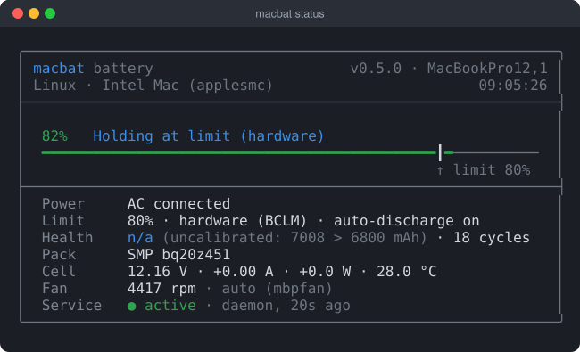
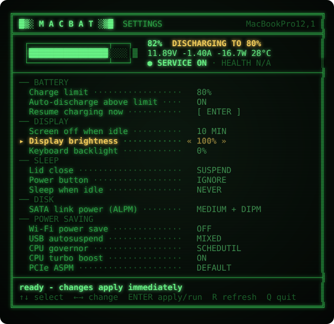
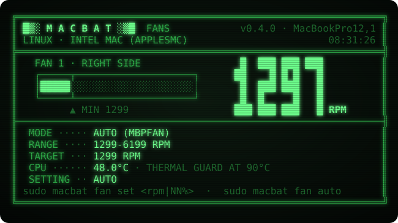

# macbat

**Battery charge limiter, fan control, battery status and power settings for Apple laptops** — Intel MacBooks running Linux, and macOS (Apple Silicon / Intel).
One small native binary, no dependencies, retro green-screen UI.


*`macbat status` on a MacBook Pro 2015 (MacBookPro12,1) with Ubuntu 24.04: charge limit 80 % held by the SMC (`BCLM`), the fan driven by mbpfan.*

- **Charge limit** — keep the battery at e.g. 80 % to slow down wear.
  Linux / Intel Macs use the SMC's own hardware limit (`BCLM`); Apple Silicon pauses charging through the SMC (`CHTE`).
- **Auto-discharge** — when the battery is 3 % or more above the limit, macbat bypasses the AC adapter so the battery drains down to the limit *while plugged in*, then hands power back to the adapter.
- **Fan control** — see every fan's speed, min / max and mode; pin a fixed speed (`sudo macbat fan set 3000` or `50%`) or go back to automatic (`sudo macbat fan auto`). Speeds are always kept inside the fan's own min..max — fans are never stopped — and a thermal guard hands control back to the SMC if the CPU reaches 90 °C.
- **Battery status** — charge, mode, adapter, health, cycles, voltage / current / power, temperature, time left, fan speed.
- **Settings screen** — run `macbat` and change everything with the arrow keys: charge limit, fan speed, screen-off-when-idle, brightness, keyboard backlight, lid / power button / idle sleep, disk power saving, Wi-Fi / USB / CPU / PCIe power saving. Changes apply immediately and survive reboots.


*`macbat` (no arguments) opens the settings screen — shown here read-only, as a normal user; run it with `sudo` (or press **S**) to change values.*


*`macbat fan`: live fan speed against the fan's min..max range, who controls it, and the CPU temperature.*

<sub>The screenshots are real output from the MacBook Pro above, captured with `packaging/capture.py` and rendered by `packaging/ansi2svg.py`.</sub>

## Install

One line, needs only `sh` and `curl` (or `wget`) — the right binary for your OS is downloaded from the latest release and checked against `SHA256SUMS`:

```sh
curl -fsSL https://raw.githubusercontent.com/neuralfoundry-coder/macbat/main/install.sh | sudo sh
```

It installs `/usr/local/bin/macbat` and starts the background service (limit 80 %, auto-discharge on).

- Check first without changing anything: `curl -fsSL …/install.sh | MACBAT_DRY_RUN=1 sh`
- Specific version: `… | sudo MACBAT_VERSION=0.4.0 sh`

**Packages** (from the [releases page](https://github.com/neuralfoundry-coder/macbat/releases)):

| | |
|---|---|
| Ubuntu / Debian (Intel Mac) | `sudo apt install ./macbat_0.4.0_amd64.deb` |
| macOS | `macbat-0.4.0-macos-universal.pkg` — unsigned: right-click → Open, or `sudo installer -pkg macbat-0.4.0-macos-universal.pkg -target /` |

**From source:** `make && sudo ./macbat install` (Linux needs a C compiler; macOS needs the Xcode command line tools).

## Usage

| | |
|---|---|
| `macbat` | settings screen (read-only unless run with `sudo`; press **S** to relaunch with sudo) |
| `macbat status` | status page — add `--plain` or `--json` for scripts |
| `sudo macbat limit 80` | charge limit 20–100 (`off` = 100) |
| `sudo macbat discharge on\|off` | auto-discharge down to the limit while plugged in |
| `sudo macbat restore` | resume charging, re-enable the adapter and give the fans back to automatic control, right now |
| `macbat fan` | fan page — speed, min / max, target, mode (`--plain` / `--json` too) |
| `sudo macbat fan set 3000` | fixed fan speed in RPM, clamped to the fan's min..max |
| `sudo macbat fan set 50%` | fixed speed as a share of the fan's range (0 % = min, 100 % = max) |
| `sudo macbat fan auto` | automatic fan control again (SMC, or mbpfan if macbat paused it) |
| `sudo macbat install` / `uninstall` | add / remove the service (uninstall restores 100 % and normal charging) |
| `macbat keys` | the relevant SMC keys (diagnostics) |

Settings screen keys: **↑ ↓** select · **← →** change · **Enter** apply / run · **R** refresh · **Q** quit.
Colours: `MACBAT_THEME=amber` for an amber screen, `NO_COLOR=1` for none.

### What the settings screen controls

| Section | Linux (Intel Mac) | macOS |
|---|---|---|
| Battery | charge limit, auto-discharge, resume charging now | same |
| Fans | fan speed: AUTO or 0–100 % of the fan's range, with the live RPM | same (experimental) |
| Display | screen off when idle (console blanking), display brightness, keyboard backlight | display sleep |
| Sleep | lid close, power button, sleep when idle (systemd-logind) | system sleep, Power Nap, low power mode |
| Disk | SATA link power management (ALPM), disk spin-down (rotational disks) | disk sleep |
| Power saving | Wi-Fi power save, USB autosuspend, CPU governor, CPU turbo, PCIe ASPM | — |

How settings persist on Linux: battery and screen blanking live in `/etc/macbat.conf` and are re-applied by the service at boot; lid / power button / idle go to `/etc/systemd/logind.conf.d/90-macbat.conf`; brightness is restored by systemd. If **TLP** is installed, disk / Wi-Fi / USB / CPU / PCIe settings are written to `/etc/tlp.d/90-macbat.conf` so TLP and macbat never fight; otherwise the macbat service re-applies them at boot. On macOS the settings go through `pmset`.

`/etc/macbat.conf`:

```ini
limit=80
auto_discharge=on
hysteresis=3      # band: auto-discharge starts at limit+3 %; software limit (Apple Silicon) resumes charging at limit-3 %
interval=30       # seconds between checks
screen_blank=600  # set from the settings screen
fan=auto          # auto, an RPM (3000) or a share of the fan's range (50%) - set with `macbat fan`
```

## How it works

macbat talks to the System Management Controller directly and only uses keys it finds on the machine.

| Platform | Charge limit | Auto-discharge (bypass adapter) | Battery data |
|---|---|---|---|
| Linux, Intel Mac | `BCLM` — enforced by the SMC itself | `ACEN`=0 (or `CH0I`=1) | `/sys/class/power_supply`, SMC |
| macOS, Apple Silicon | `CHTE` (or `CH0B`/`CH0C`), toggled by the service with hysteresis | `CHIE`=0x08 (or `CH0I`) | `AppleSmartBattery`, SMC |
| macOS, Intel | `BCLM` | `CH0I` | `AppleSmartBattery`, SMC |

- **Linux**: reads go through the `applesmc` driver. Writes use the SMC I/O ports (0x300/0x304) with the same protocol as the kernel driver; while writing, macbat briefly stops `mbpfan` and unloads `applesmc` so nothing else talks to the SMC, then reloads it, restarts `mbpfan` and verifies the value. Writes only happen when something changes. Requires kernel lockdown to be off (the default on Macs, which do not Secure-Boot Linux).
- **macOS**: uses the `AppleSMC` IOKit user client and IOKit sleep notifications.

### Fan control

| Platform | Read | Manual speed | Automatic |
|---|---|---|---|
| Linux, Intel Mac | `applesmc` sysfs `fanN_input/min/max/output/manual` (no root needed) | `fanN_manual=1`, `fanN_output=<rpm>` | `fanN_manual=0` |
| macOS, Apple Silicon *(experimental)* | SMC `FNum`, `F<n>Ac/Mn/Mx/Tg` (float), `F<n>Md` | `Ftst=1` (where present), `F<n>Md=1`, `F<n>Tg` | `F<n>Md=0`, `Ftst=0` |
| macOS, Intel *(experimental)* | SMC `F<n>Ac/Mn/Mx/Tg` (fpe2), `FS!` | `FS!` bit set, `F<n>Tg` | `FS!` bit cleared |

- The requested speed is clamped to each fan's own minimum and maximum, so a fan never runs below the SMC minimum and can never be switched off. `NN%` means a position in that range (0 % = minimum, 100 % = maximum).
- **mbpfan** (and `macfanctld`) run the fans themselves and would override a fixed speed within a second. macbat leaves them alone until you ask for a manual speed: then it stops the daemon, disables it (if it was enabled) so it stays off after a reboot, notes that in `/etc/macbat.conf`, and says so. `macbat fan auto` — and `macbat uninstall` — enable and start it again. If you start mbpfan yourself in the meantime, macbat sees it and leaves the fans to it.
- The service keeps the manual speed: it re-applies it after boot, after resume and whenever something resets the SMC. Before the machine sleeps, when the service stops and on `macbat restore`, the fans go back to the SMC's automatic control.
- **Thermal guard** (Linux, Intel macOS): while a manual speed is set, the service checks the CPU temperature every 2 s; at 90 °C it hands the fans back to the SMC and only returns to the manual speed once the CPU is down to 75 °C.
- **macOS fan writes are experimental and untested on real hardware** (they follow the keys used by other fan tools; Apple Silicon has no thermal guard because there is no single CPU temperature key). Reading fan speeds on macOS is tested. macbat refuses to change fans while Macs Fan Control, TG Pro or smcFanControl is running (`--force` overrides).

### Safety

- When the service stops — or crashes (`ExecStopPost` on Linux) — charging and the adapter go back to normal.
- Before the machine sleeps, charging and the adapter go back to normal (systemd sleep hook / IOKit sleep notification), so a plugged-in laptop never drains while asleep. Fans go back to automatic control at the same moments.
- Auto-discharge starts only `hysteresis` % (default 3) above the limit, so a battery that sits at limit / limit + 1 % does not make macbat switch the adapter back and forth.
- Fans: never below their minimum, never off, thermal guard at 90 °C (see *Fan control*).
- Below 10 % macbat never pauses charging or bypasses the adapter.
- If **AlDente** or **Battery Toolkit** is running, macbat refuses to touch charging (`--force` overrides) and says so on the status page.
- Changing the lid action is refused while the lid is closed (it would take effect immediately).
- Battery health is reported as *n/a (uncalibrated)* when the fuel gauge claims more than the design capacity, instead of a misleading value above 100 %.

These SMC keys are undocumented. Behaviour was verified on the machines below; use at your own risk.

### Tested on

| Machine | OS | What was verified |
|---|---|---|
| MacBookPro12,1 (13" 2015) | Ubuntu 24.04, kernel 6.8 | everything: `BCLM` limit, `ACEN` auto-discharge, service start/stop/restore, sleep hook, `.deb` install/remove, settings screen (brightness, keyboard backlight, blanking, ALPM, turbo via TLP); 0.4.0 fan control: `fan set` / `fan auto`, clamping to the minimum, mbpfan pause / resume, service re-applying the speed after `restore` and after a restart |
| Mac16,5 (M4 Max) | macOS 26.5 | status, SMC reads, fan reads, settings screen (read-only), AlDente detection; `CHTE` / `CHIE` writes verified with the 0.1 prototype; fan writes **not** tested |

Intel Macs running macOS: implemented but not tested — reports welcome. Not yet exercised on real hardware: the thermal guard tripping at 90 °C, and fan behaviour across suspend / resume.

## Support

macbat is free and MIT-licensed. If it keeps your battery (or your ears) happy, you can support its development through **[GitHub Sponsors](https://github.com/sponsors/neuralfoundry-coder)** — or the *Sponsor* button at the top of the repository. Bug reports and test results from other Mac models help just as much.

---

## 한국어 요약

Apple 노트북용 **배터리 충전 제한 · 배터리 상태 · 전원 설정** 도구입니다. 의존성 없는 네이티브 실행 파일 하나이고, 레트로 그린 스크린 UI를 씁니다.

```sh
curl -fsSL https://raw.githubusercontent.com/neuralfoundry-coder/macbat/main/install.sh | sudo sh   # 설치 + 서비스 시작
macbat            # 설정 화면 (↑↓ 선택, ←→ 변경, Enter 실행, Q 종료)
macbat status     # 상태 화면
macbat fan        # 팬 화면 (속도, 최소/최대, 모드)
sudo macbat fan set 3000   # 팬 고정 속도 (RPM 또는 50% 같은 비율, 최소~최대 범위로 제한)
sudo macbat fan auto       # 자동 팬 제어로 복귀
```

- **충전 제한**: 인텔 맥 리눅스는 SMC 하드웨어 제한(`BCLM`), Apple Silicon은 충전 중지(`CHTE`)
- **자동 방전**: 제한보다 3% 이상 높으면 어댑터를 우회해서, 꽂아 둔 채로 제한치까지 방전
- **팬 제어**: 팬 속도·최소/최대·모드 표시, 고정 속도 설정과 자동 복귀. 항상 팬의 최소~최대 범위 안에서만 설정하고(팬을 끌 수 없음), CPU가 90 °C에 닿으면 자동 제어로 돌려 줍니다. 리눅스에서 mbpfan이 돌고 있으면 고정 속도를 요청할 때만 멈추고(비활성화), `fan auto`로 다시 켭니다. macOS 팬 쓰기는 실험 기능입니다.
- **설정 화면**: 충전 제한, 팬 속도, 입력 없을 때 화면 끄기, 밝기, 키보드 백라이트, 덮개 / 전원 버튼 / 유휴 잠자기, 디스크 절전(ALPM, 스핀다운), Wi-Fi / USB / CPU / PCIe 절전. 바로 적용되고 재부팅 후에도 유지됩니다(TLP가 있으면 TLP 설정으로 저장).
- **안전장치**: 서비스가 멈추거나 잠자기에 들어가면 정상 충전과 자동 팬 제어로 복구합니다. 10% 이하에서는 충전을 막지 않습니다. AlDente가 실행 중이면 충전 설정에 손대지 않습니다.

비공개 SMC 키를 사용하므로 위 표의 기기에서 검증된 동작이며, 사용 책임은 사용자에게 있습니다.

### 후원

macbat은 MIT 라이선스의 무료 소프트웨어입니다. 도움이 되었다면 **[GitHub Sponsors](https://github.com/sponsors/neuralfoundry-coder)**(저장소 상단의 *Sponsor* 버튼)로 개발을 후원해 주세요. 다른 맥 모델에서의 테스트 결과와 버그 제보도 큰 도움이 됩니다.

## License

MIT
